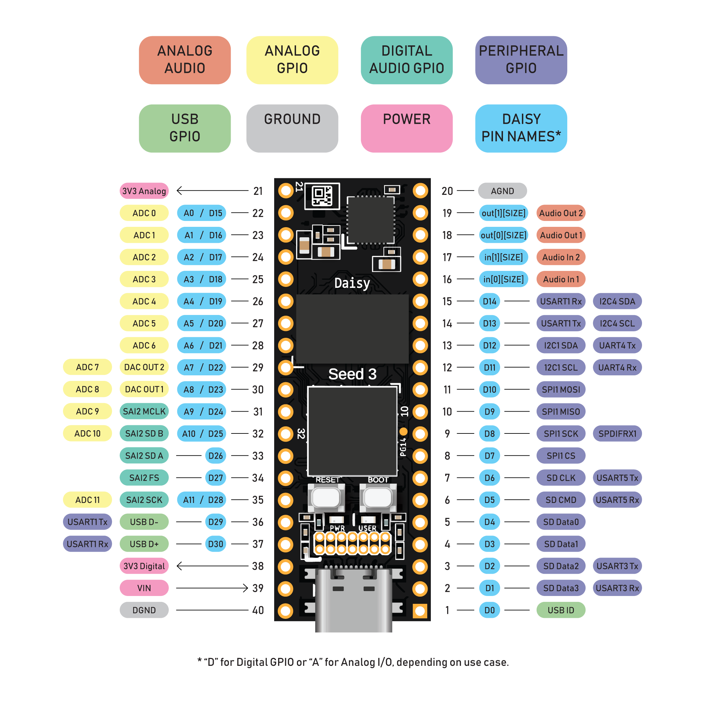
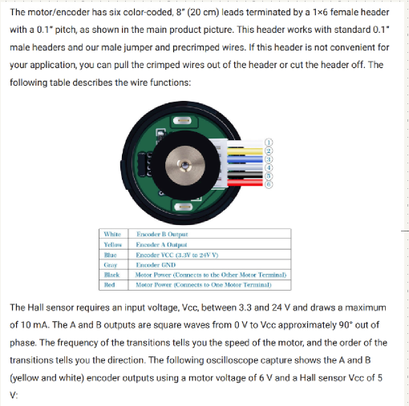
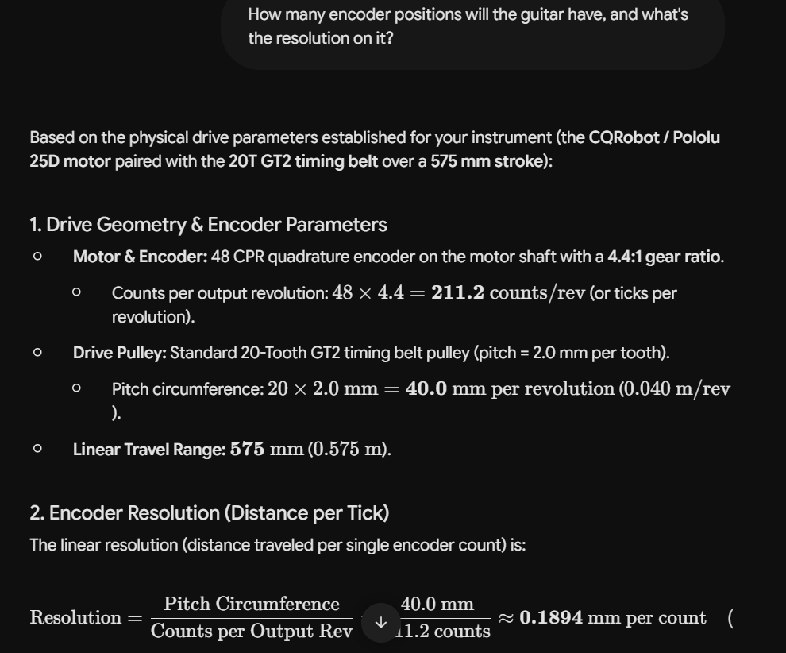
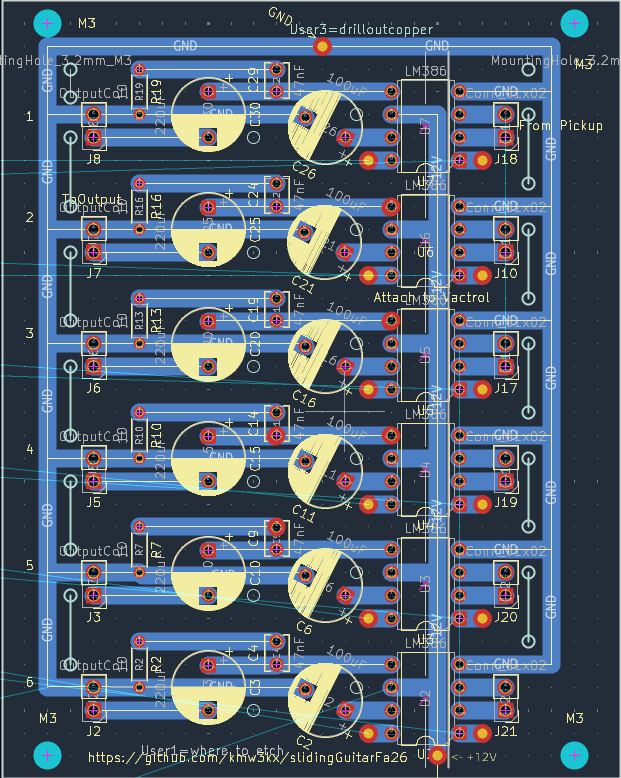
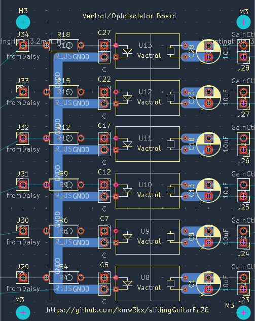
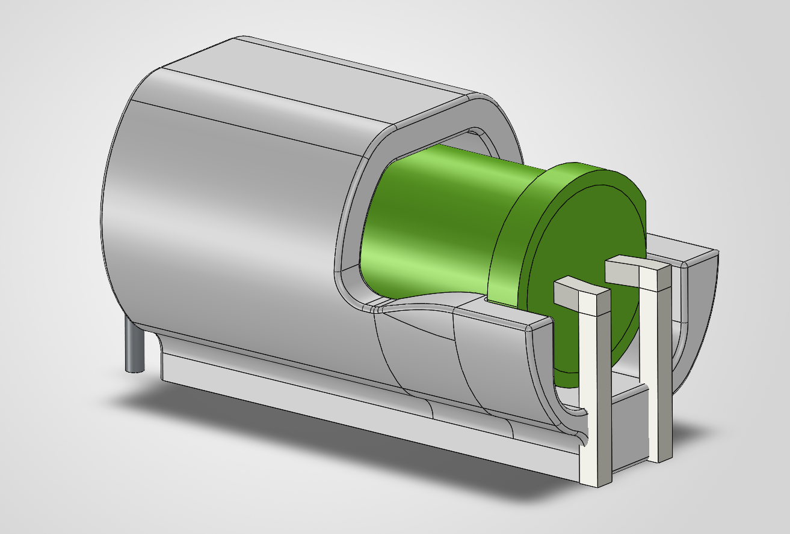
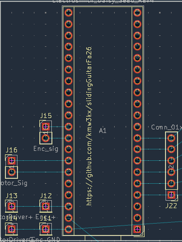
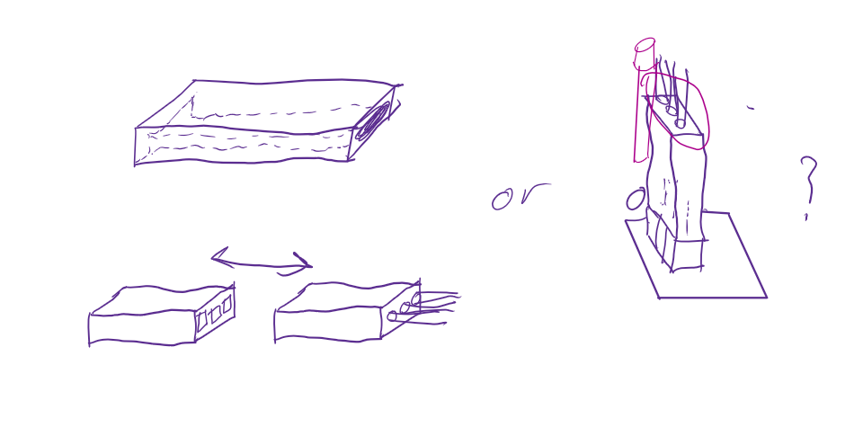
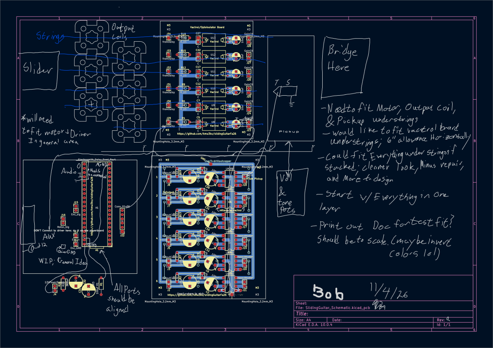

# slidingGuitarFa26
Repo for all of the electronics &amp; code for my Fa26 capstone group 

## Daisy Pins

## Basic idea

6 string guitar with glass slider attached to linear actuator.

From gemini:

$$\text{Total Encoder Positions} = \frac{575\text{ mm}}{0.1894\text{ mm/count}} \approx \mathbf{3,036\text{ discrete positions}}$$

My original idea was to use pitchbend midi control for slider position, but it doesn't appear to be completely necessary. But it will fit for now.

Then I will use a cc channel or 2 for the gains on the Op-amps

I will build this demo in puredata so that I can start composing for it.

## Work Log

### 11-1-26 
-Bob: I was able to work on the pcb designs for the guitar. Still need to do the power supply board, but want to wait until we further define what parts we'll use for that (especially since I've already built a prototype for it). 

Here's the amplifier board. Should be able to be mounted near the output coils:

Here's the vactrol/optoisolator board. This is designed to be placed directly under the strings so that the exposed LED's will show which strings are being played automatically:

I've designed a 3D-printed structure for the vactrols. I'm thinking that a single part will be printed to hold all 6 LSR's and LED's in place, with a case to fully cover the LED's (besides just a lil peep hole). While these parts might be able to be held by the soldered lsr, they really should be screw-mounted. 

Here's the daisy board; note that the design isn't completely done: 

Some notes about the boards:
-Not all traces have been fully added; these are designed to be put on stripboard. I have been experimenting with using a small desktop CNC to etch pcb traces, but I've been fairly unsuccessful due to the copper delaminating. I'm hoping that stripboard will allow the boards to be easier to fabricate; any breaks to be cut have been noted on the user.1/3 layers: etching & drilling respectively. I've been using Carbide Create/Motion to generate and run the gcode for the CNC
-I want to use 3D printing, pin header and sockets, and standard dupont connectors for these boards, since they are what is most readily available. My idea is that small 3D-printed sleeves can go around each dupont in a single structure that can be screwed to the mount under the board. Need to design this to communicate the idea better. More screwholes may need to be added to make mounting more repairable.
-Need to clarify what exactly is being soldered into each space. For example, the motor signal holes will likely just have dupont wires soldered to the board, and then the above idea will be on the H-bridge board.
-I'm thinking that the silkscreen will be able to be put on the stripboard using a CO2 laser for etching. Maybe etch onto painters tape, and then spray paint for actual white text (DIY technique I've seen online).

### 11-4-26
-Bob: I've been working on terminations/connectors for the wiring,  & ensuring the last daisy seed3 doesn't get fried by the motor driver (RIP). Also building up the courage to get back to working on that. 

Dupont connectors are so ubiquitous, it makes sense to use them and just make 3D printed cases to keep them connected. But I'm not sure if connecting them as butt joints, or turning them into vga cables is best:

I've gone ahead and laid out the boards in a practical arrangement to fit onto the body of the guitar. I'm hoping this graphic will be suitable for the team to start working on laying out where everything goes, and how everything will be wired up. I wish I could find a way to better render these boards individually into step files, but laying them out in KiCAD is suitable for now. 
