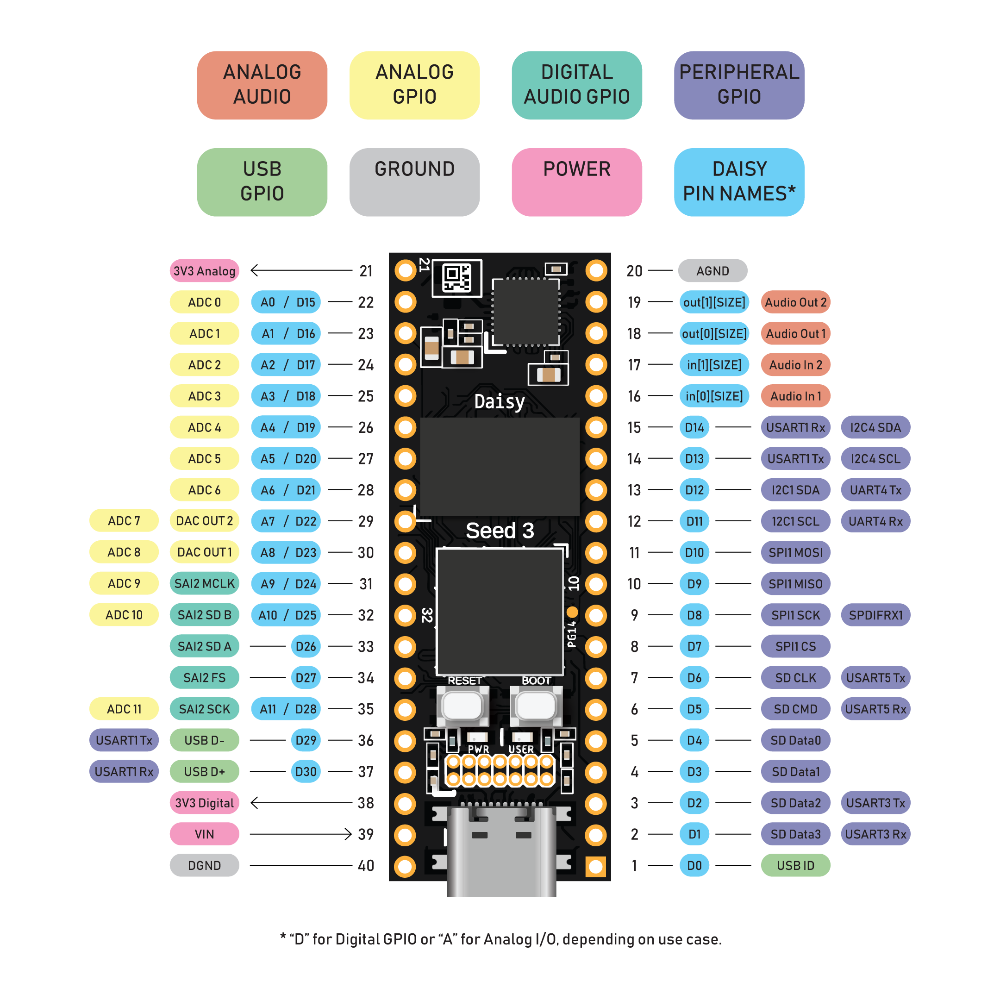
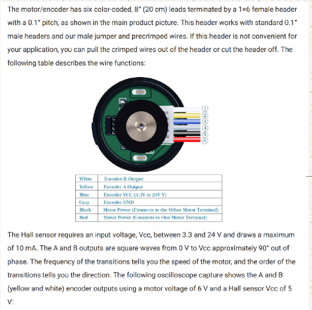
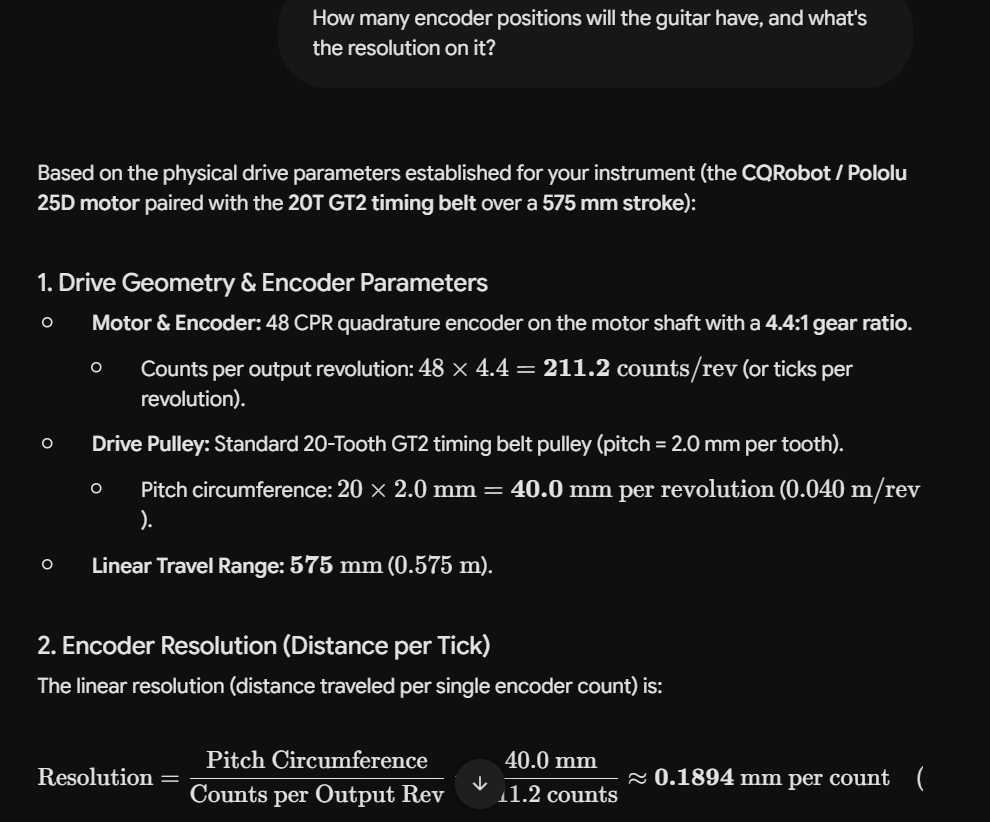

# slidingGuitarFa26
Repo for all of the electronics &amp; code for my Fa26 capstone group 

## Daisy Pins

## Basic idea

6 string guitar with glass slider attached to linear actuator.

From gemini:

$$\text{Total Encoder Positions} = \frac{575\text{ mm}}{0.1894\text{ mm/count}} \approx \mathbf{3,036\text{ discrete positions}}$$

My original idea was to use pitchbend midi control for slider position, but it doesn't appear to be completely necessary. But it will fit for now.

Then I will use a cc channel or 2 for the gains on the Op-amps

I will build this demo in puredata so that I can start composing for it.
